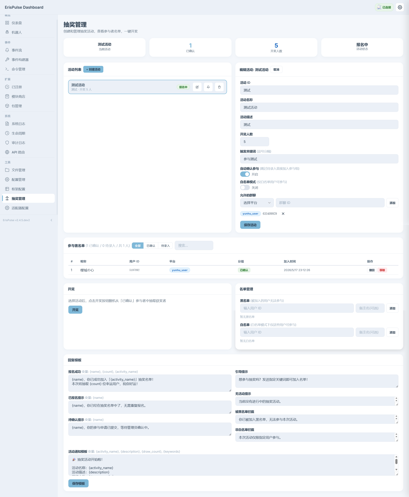

[English](README.md) | [简体中文](README.zh-CN.md) | [繁體中文](README.zh-TW.md) | [日本語](README.ja.md) | [Русский](README.ru.md)

<div align="center">


# ErisPulse-Raffle

**General raffle module with Dashboard visualization, keyword signup & draw animation**

<p>
  <a href="https://pypi.org/project/ErisPulse-Raffle/"></a>
  <a href="https://pypi.org/project/ErisPulse-Raffle/"></a>
  <a href="https://github.com/ErisPulse/ErisPulse/blob/main/LICENSE"></a>
  
</p>

</div>

---

## Features

- **Dashboard management** — create/edit activities, manage participants and allow/deny lists, draw winners in one click
- **Keyword signup** — users join by sending the configured keyword in group chat, no @mention needed
- **Multi-platform** — works across Yunhu, Telegram, OneBot and more via adapters
- **Draw rollback** — revert a draw and restore the activity to signup state
- **Activity notifications** — send start notifications from the Dashboard to any platform/chat (batch sending to multiple targets)
- **Draw broadcast** — automatically broadcast results to all linked groups after a draw
- **Rich-text fallback** — the `/raffle` command picks Html / Markdown / plain text based on platform capability
- **Custom templates** — every reply message (signup, broadcast, notification…) is customizable
- **Prize claiming** — three claim modes: direct content, custom info collection, custom instructions
- **Friend-add reminder** — winners adding the bot as friend automatically get a claim reminder

## Install

```bash
epsdk install Raffle
```

## Usage

### Group signup

Users send the activity keyword in a linked group to join:

```
抽奖          # just send the configured keyword
```

### Check activities

```
/raffle       # my activities + this group's activities
/活动          # Chinese alias
```

### Dashboard

Install [ErisPulse-Dashboard](https://pypi.org/project/ErisPulse-Dashboard/) and find "Raffle" under the "Tools" group in the sidebar.

## Activity settings

| Setting | Description |
|------|------|
| Activity ID | Unique identifier, auto-generated if empty |
| Name | Display name |
| Description | Short description |
| Winner count | Number of winners to draw |
| Keywords | Comma-separated; messages containing a keyword count as signup |
| Auto-confirm | Skip the "pending" state and join the confirmed group directly |
| Allowlist mode | Only allowlisted users may join |
| Allowed chats | Which platforms/groups can join this activity |

## Prize claiming

After a draw, winners trigger the claim flow with a claim keyword (e.g. "兑奖" / "领奖"). Admins configure the claim mode per activity:

| Mode | Description |
|------|------|
| Direct content | Automatically sends the preset content to the winner (per-user overrides supported) |
| Collect info | Collects admin-defined fields from the winner via multi-turn conversation |
| Custom instructions | Sends custom instructions guiding the winner through the claim |

### Info collection

Admins define the fields (field key + prompt) in the activity form; during a claim the winner is asked for each field in order. Fields are fully admin-defined with no presets.

### Friend-add reminder

When enabled, adding the bot as friend automatically sends winners a claim reminder. The system scans all drawn activities and matches winner identities.

### Claim settings

| Setting | Description |
|------|------|
| Claim mode | One of: direct / collect / instructions |
| Claim keywords | Comma-separated triggers |
| Content | What to send in "direct" mode |
| Fields | Field list for "collect" mode |
| Instructions | Text shown in "instructions" mode |
| Listen for friend adds | Auto-remind winners on friend add |
| Per-user content | Different direct-send content per user, set in the Dashboard |

### Claim records

The "Claims" panel in the Dashboard lists all claims; admins can view collected info, mark claims as done, and edit per-user content.

## Notifications

Click the bell next to an activity in the Dashboard to send a notification:

- Pick platform, chat type (DM/group/channel/server/topic) and target ID
- Optionally pick a bot account (multi-bot setups)
- Optional custom note appended to the template
- Batch sending to multiple targets
- Send history + one-click resend

## Reply templates

All replies are customizable in the Dashboard's "Reply templates" section:

| Template | Trigger | Variables |
|------|---------|------|
| Signup success | First successful signup | `{name}`, `{count}`, `{activity_name}` |
| Already joined | Duplicate signup | `{name}` |
| Pending hint | Signup in manual-confirm mode | `{name}` |
| Draw broadcast | Broadcast after draw | `{activity_name}`, `{winner_names}`, `{winner_count}`, `{total_participants}` |
| Notification | Sent from Dashboard | `{activity_name}`, `{description}`, `{draw_count}`, `{keywords}` |
| Claim success | Winner completes claiming | `{name}` |
| Friend-add reminder | Winner adds the bot | `{name}` |
| Blocklist deny | Blocklisted user tries to join | - |
| Allowlist deny | Non-allowlisted user tries (in allowlist mode) | - |

## Screenshots



## API

The module registers these HTTP APIs (Dashboard token auth required):

| Route | Method | Description |
|------|------|------|
| `/Raffle/api/platforms` | GET | Registered platform list |
| `/Raffle/api/settings` | GET/PUT | Read/update module settings |
| `/Raffle/api/activities` | GET/POST | List/create activities |
| `/Raffle/api/activities/{id}` | GET/PUT/DELETE | View/update/delete an activity |
| `/Raffle/api/activities/{id}/participants` | GET | Participant list |
| `/Raffle/api/activities/{id}/participants/{uid}` | PUT/DELETE | Confirm/revert/remove participant |
| `/Raffle/api/activities/{id}/draw` | POST | Draw winners |
| `/Raffle/api/activities/{id}/draw/revert` | POST | Revert a draw |
| `/Raffle/api/activities/{id}/result` | GET | Draw result |
| `/Raffle/api/activities/{id}/blacklist` | GET/PUT | Blocklist |
| `/Raffle/api/activities/{id}/whitelist` | GET/PUT | Allowlist |
| `/Raffle/api/activities/{id}/notify` | POST | Send notification |
| `/Raffle/api/activities/{id}/notify/history` | GET | Notification history |
| `/Raffle/api/activities/{id}/notify/resend/{hid}` | POST | Resend |
| `/Raffle/api/activities/{id}/claims` | GET | Claim records |
| `/Raffle/api/activities/{id}/claims/{uid}` | PUT | Update claim status / per-user content |

## Commands

| Command | Alias | Description |
|------|------|------|
| `/raffle` | `/活动` | View joined activities and this group's activities |

## License

MIT
